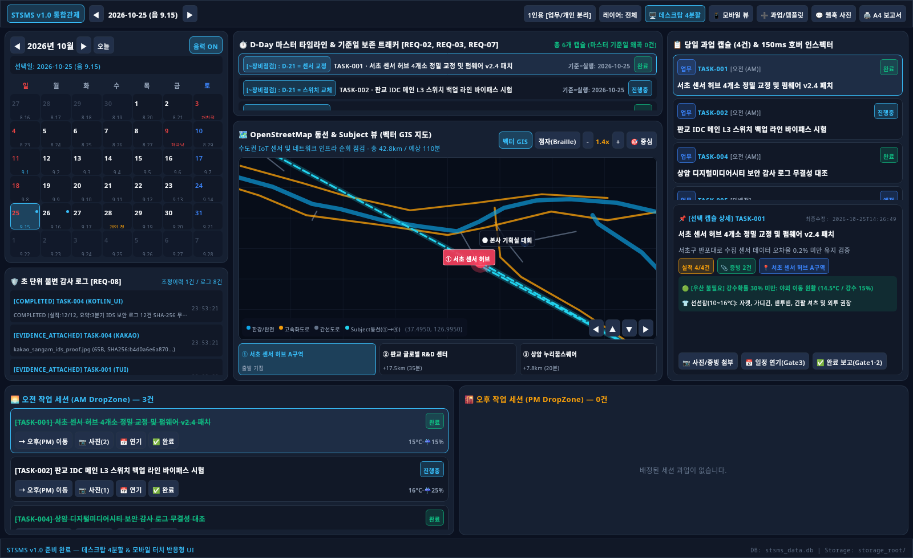
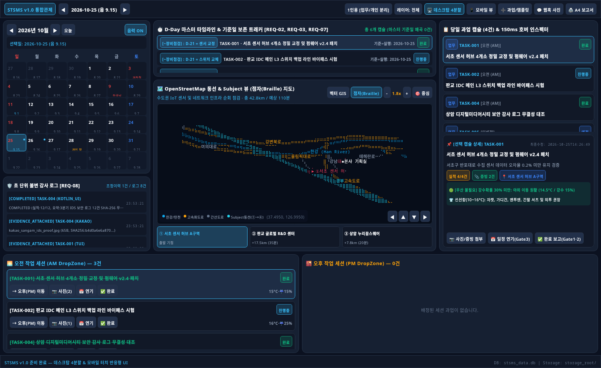
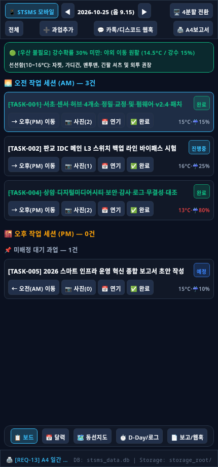
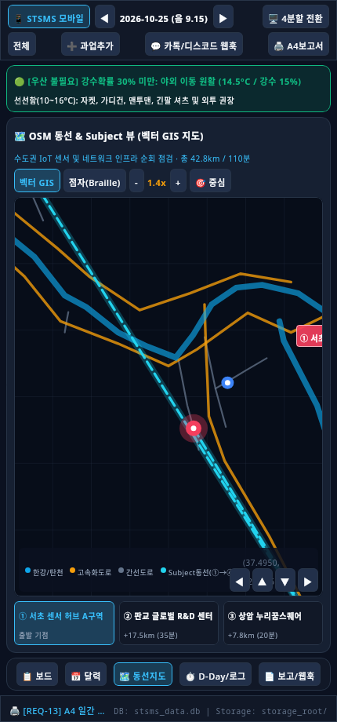

# STSMS (Smart Task & Schedule Management System) v1.0

스마트 업무·일정 추적 및 동선·환경 보조 시스템 (STSMS v1.0)

> 기준 사양서: `SPEC-STSMS-2026-V1.0` ([`STSMS_AI_Coding_Technical_Specification.md`](STSMS_AI_Coding_Technical_Specification.md))

---

## 📸 UI 프리뷰 (데스크탑 4분할 & 모바일 터치)

### 데스크탑 4분할 관제 대시보드
| 벡터 GIS 지도 모드 | MapSCII 점자(Braille) 지도 모드 |
| :---: | :---: |
|  |  |

### 모바일 터치 최적화 뷰 (스마트폰 & Android)
| 오전/오후 터치 보드 | 동선 & Subject 지도 |
| :---: | :---: |
|  |  |

---

## 🚀 주요 기능

1. **업무 객체 캡슐화 (Task Object Encapsulation)**:
   - 4대 비즈니스 유효성 검증 게이트 (Gate 1 보고필수 검증, Gate 2 사진증빙 검증, Gate 3 일정연기 마스터보존 검증, Gate 4 기상/복장/우산 판단)
2. **한국 양력/음력 듀얼 캘린더 (Dual Calendar Engine)**:
   - 2024~2030년 한국 전통 음력(윤달 포함, 2025년 윤6월 완벽 지원) 및 법정 공휴일/연차 관리
3. **OpenStreetMap 동선 시각화 (CORE-03)**:
   - 수도권 도로망/한강/탄천 실제 OSM 데이터 기반
   - Compose Canvas 기반 **벡터 GIS 지도** & 2x4 서브픽셀 **유니코드 점자(`U+2800`..`U+28FF`) MapSCII 지도** 지원
   - Subject 경유지(`① → ② → ③ → ④`) 순회 거리(km) 및 예상 소요시간(분) 시각화
4. **오전(AM) / 오후(PM) 2열 드래그·터치 보드 (REQ-09)**:
   - 1-클릭 세션 전환, 동적 체크리스트, 즉시 증빙 첨부/연기/완료 처리
5. **파일시스템 증빙 & SHA-256 무결성 검증 (REQ-05 / EXT-03)**:
   - `storage_root/YYYY/MM/DD/TASK_ID/` 자동 적재 및 FIPS 180-4 표준 SHA-256 해시 검증
6. **메신저 Webhook 자동 매핑 (REQ-10, REQ-11)**:
   - 3단계 우선순위 알고리즘 (#단축태그 매칭 → 활성세션 단일업무 매칭 → 대화형 퀵리플라이 선택)
7. **A4 일간 보고서 원클릭 출력 (REQ-13)**:
   - Markdown (`daily_report_YYYYMMDD.md`) 및 `@media print` A4 인쇄 CSS 적용 정형 HTML (`daily_report_YYYYMMDD.html`) 동시 생성

---

## 🛠️ 프로젝트 구성

- **Rust TUI 버전 (`src/`)**:
  - `ratatui` + `crossterm` + `rusqlite`
  - 터미널 CLI 환경에서 초경량 점자 지도 및 4분할 레이아웃 구동
- **Kotlin Multiplatform 버전 (`kotlin-stsms/`)**:
  - Compose Multiplatform (Desktop JVM + Android)
  - 단일 코드베이스로 데스크탑 4분할 화면과 모바일 5탭 터치 반응형 화면 동시 지원

---

## 💻 실행 방법

### 1. Rust TUI 실행
```bash
cargo run --release
```

### 2. Kotlin 데스크탑 실행
```bash
cd kotlin-stsms
gradle run
```

### 3. Android APK 빌드
```bash
cd kotlin-stsms
gradle assembleDebug
# APK 파일: kotlin-stsms/build/outputs/apk/debug/kotlin-stsms-debug.apk
```
