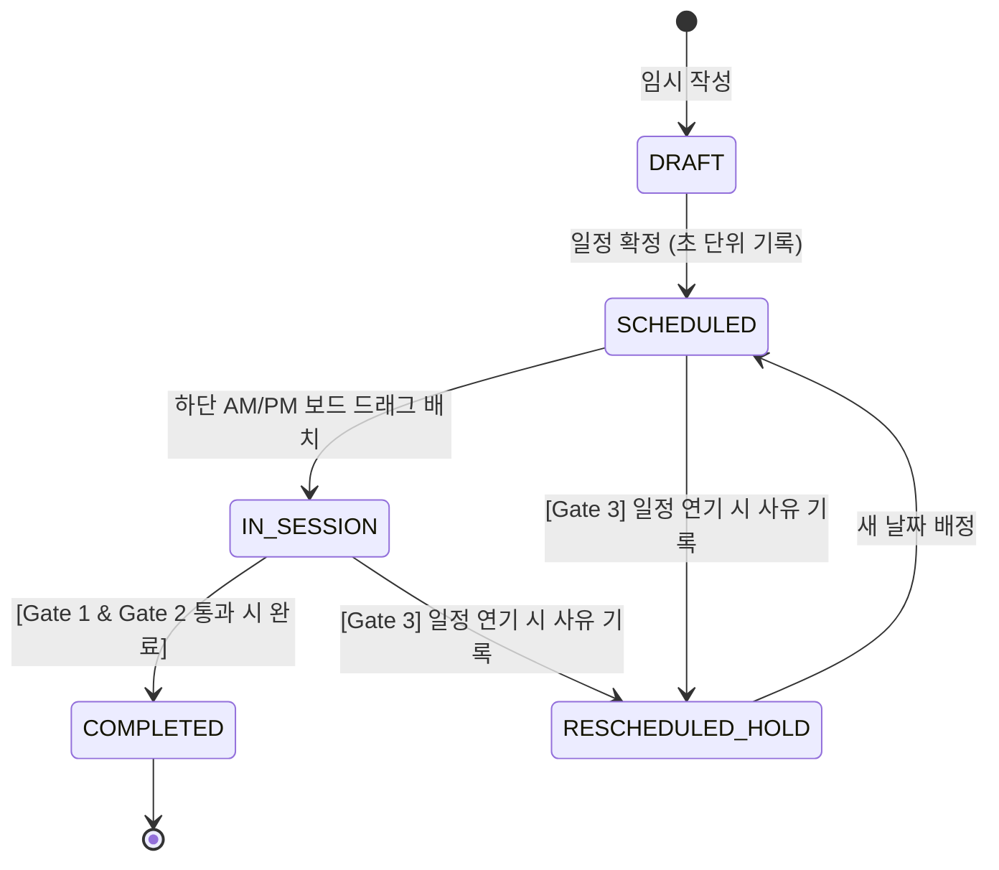

# [AI Coding Guide] Nix's Smart Task & Schedule Management System (STSMS) v1.0
> **문서 목적**: 본 기술 문서는 LLM 및 AI 코딩 에이전트(Cursor, Claude Code, Antigravity, Copilot 등)가 `STSMS (스마트 업무·일정 추적 및 동선·환경 보조 시스템)`의 프론트엔드, 백엔드, 데이터베이스 및 외부 연동 파이프라인을 오류 없이 일관되게 구현할 수 있도록 작성된 **AI 코딩 전용 상세 기술 사양서(Technical Specification for AI Coding)**입니다.
> 
> **기준 문서**: `SPEC-STSMS-2026-V1.0` (Smart_Task_Schedule_System_Spec_v1.0.docx)

---

## 📑 목차 (Table of Contents)
1. [시스템 아키텍처 및 우선순위 거버넌스 (Priority Tier)](#1-시스템-아키텍처-및-우선순위-거버넌스)
2. [권장 기술 스택 및 프로젝트 디렉터리 구조](#2-권장-기술-스택-및-프로젝트-디렉터리-구조)
3. [데이터베이스 DDL 및 무결성 제약조건 (PostgreSQL / SQLite)](#3-데이터베이스-ddl-및-무결성-제약조건)
4. [핵심 도메인 타입 정의 (TypeScript & Python Pydantic)](#4-핵심-도메인-타입-정의)
5. [비즈니스 로직 가드레일 & 상태 머신 (Validation Gates)](#5-비즈니스-로직-가드레일--상태-머신)
6. [REST API 및 메신저 Webhook 상세 명세](#6-rest-api-및-메신저-webhook-상세-명세)
7. [UI/UX 컴포넌트 구조 및 인터랙션 사양](#7-uiux-컴포넌트-구조-및-인터랙션-사양)
8. [단계별 AI 구현 프롬프트 및 검증 기준 (Definition of Done)](#8-단계별-ai-구현-프롬프트-및-검증-기준)

---

## 1. 시스템 아키텍처 및 우선순위 거버넌스

### 1.1 4대 핵심 아키텍처 철학 (AI 코딩 시 불변 원칙)
1. **업무 객체 캡슐화 (Task Object Encapsulation)**: 개별 업무는 단순 텍스트가 아닌 독립 캡슐 객체(`TaskCapsule`)로 존재해야 하며, 상태 변경 및 속성 수정은 반드시 전용 검증 메서드를 통과해야 합니다.
2. **마스터 스케줄 불변성 및 독립 조정 (Baseline Isolation)**: D-Day 템플릿의 전체 기준 기간(Baseline)과 하위 세부 실행 업무(Actionable Task)는 엄격히 분리됩니다. 특정 업무의 실행일을 연기/조정하더라도 사유(`reason`)만 기록할 뿐, 원본 마스터 기준선에는 연쇄 왜곡을 주지 않습니다 (`master_baseline_affected = false`).
3. **초(Second) 단위 무결성 감사 추적 (Second-Precision Auditability)**: 최초 확정 시각(`scheduled_fixed_at`), 생성 시각(`created_at`), 모든 수정 시각(`last_modified_at`)은 초 단위(ISO 8601 `YYYY-MM-DD HH:mm:ss` 또는 밀리초 타임스탬프)로 보존되며 불변 이력(`task_audit_logs`)에 기록됩니다.
4. **공간(Subject 동선) 및 환경(날씨) 컨텍스트 결합**: 여러 Task를 `Subject`로 그룹화하여 지도상에 번호 마커와 유향 폴리라인(Polyline)으로 연결하고, 업무 수행 장소의 기상청 API 데이터를 기반으로 복장(기온) 및 우산 지참(강수확률) 안내를 자동 제공합니다.

### 1.2 구현 중요도 등급 (Priority Tier Governance)
AI 구현 시 다음 우선순위 위계를 엄격히 준수합니다.

| 티어 | 명칭 | 대상 기능군 (RTM ID 매핑) | 구현 원칙 |
| :--- | :--- | :--- | :--- |
| **P0** | **필수 코어 (MVP Core)** | REQ-01(듀얼달력), REQ-02(D-Day템플릿), REQ-03(비주얼태그), REQ-04(호버설명), REQ-05(파일시스템증빙), REQ-07(독립일정조정), REQ-08(초단위로그), REQ-09(오전/오후 드래그보드), REQ-15가~라(보고강제·체크박스·사진필수·특이사항), CORE-01(업무 캡슐화) | Phase 1 최우선 개발. 미충족 시 시스템 빌드 불가 |
| **P1** | **핵심 아키텍처 (Target)** | REQ-06(돌발추가/일수연장), REQ-10(카톡/디스코드 사진 자동연동), REQ-11(챗봇 인터페이스), REQ-12(휴일색상·휴무/휴가분리), REQ-13(A4인쇄/PDF), REQ-14(다수/1인모드), REQ-15마(다주기반복), CORE-02(날씨·복장·우산보조), CORE-03(Subject 동선·거리 시각화) | Phase 2 정규 v1.0 릴리즈 필수 범위 |
| **P2** | **후순위 확장 (Plugin)** | EXT-01(EXIF GPS/시간 진위검증), EXT-02(날씨연동 준비물 프리셋), EXT-03(SHA-256 해시 및 오프라인 캐시) | Phase 3 분리 개발. 코어 완료 후 선택적 활성화 |
| **P3** | **장기 R&D (Backlog)** | EXT-04(TSP 최단동선 자동최적화·지연알림), EXT-05(OCR 증빙요약 및 챗봇 음성 STT) | Phase 4 장기 과제. 외부 AI 비용 검토 후 플러그인 연동 |

---

## 2. 권장 기술 스택 및 프로젝트 디렉터리 구조

### 2.1 기술 스택
- **프론트엔드**: React 18+ (또는 Next.js App Router / Vite SPA) + TypeScript + Tailwind CSS
- **드래그 앤 드롭**: `@dnd-kit/core`, `@dnd-kit/sortable` (오전/오후 분할 보드 및 재정렬)
- **지도 엔진**: Leaflet / React-Leaflet (또는 카카오맵 / 네이버 지도 Web API SDK)
- **백엔드**: Python FastAPI (SQLAlchemy / Pydantic v2) 또는 Node.js / Hono / Express (TypeScript)
- **데이터베이스**: PostgreSQL 15+ (개발/로컬용 SQLite WAL 모드 호환)
- **외부 API**: 한국천문연구원 특일·음력정보 API, 기상청 단기예보 Open API, Discord Bot / Kakao OpenBuilder

### 2.2 권장 프로젝트 디렉터리 구조 (Monorepo 권장)
```text
stsms-workspace/
├── apps/
│   ├── web/                         # 프론트엔드 (React + Vite/Next.js)
│   │   ├── src/
│   │   │   ├── components/
│   │   │   │   ├── calendar/        # [REQ-01, REQ-12] 양·음력 듀얼 캘린더
│   │   │   │   ├── timeline/        # [REQ-02, REQ-03] D-Day 타임라인 & 태그
│   │   │   │   ├── map/             # [CORE-03] Subject 동선 및 거리 뷰
│   │   │   │   ├── board/           # [REQ-09] 오전/오후 2열 드래그앤드롭 보드
│   │   │   │   ├── task/            # [REQ-04, 15가~마] Task 카드, 호버 팝오버, 편집 모달
│   │   │   │   ├── print/           # [REQ-13] A4 인쇄 전용 템플릿
│   │   │   │   └── weather/         # [CORE-02] 날씨·복장·우산 가이드 배지
│   │   │   ├── hooks/               # 커스텀 훅 (useTaskCapsule, useWeather, useDnd)
│   │   │   ├── stores/              # 전역 상태 (Zustand: 필터, 모드, 세션)
│   │   │   └── types/               # 프론트엔드 공유 타입 정의
│   │   └── package.json
│   │
│   ├── server/                      # 백엔드 API 서버 (FastAPI)
│   │   ├── app/
│   │   │   ├── api/v1/              # REST 엔드포인트 라우터
│   │   │   ├── core/                # 환경설정, DB 세션, 보안
│   │   │   ├── models/              # SQLAlchemy ORM 모델
│   │   │   ├── schemas/             # Pydantic v2 DTO 스키마
│   │   │   ├── services/            # 비즈니스 로직 (캡슐화 게이트, 날씨엔진, 동선엔진)
│   │   │   ├── webhooks/            # [REQ-10, 11] 카톡/디스코드 웹훅 처리기
│   │   │   └── storage/             # [REQ-05] 로컬/NAS 파일시스템 연동 매니저
│   │   ├── tests/                   # 비즈니스 가드레일 유닛 테스트
│   │   └── pyproject.toml / requirements.txt
│   │
│   └── bot/                         # [REQ-10, 11] 카카오톡/디스코드 챗봇 어댑터
│
├── storage_root/                    # [REQ-05] 로컬 첨부파일 및 보고서 저장소
│   └── YYYY/MM/DD/TASK_.../
├── docs/                            # 기술 문서 및 사양서 원본
└── README.md
```

---

## 3. 데이터베이스 DDL 및 무결성 제약조건

다음은 PostgreSQL 표준 DDL 스크립트입니다. SQLite 사용 시 `TIMESTAMP WITH TIME ZONE`을 `TEXT`로, `JSONB`를 `TEXT`로 대체하여 적용합니다.

```sql
-- 1. 사용자 및 프로필 테이블 [REQ-14]
CREATE TABLE users_profiles (
    user_id VARCHAR(64) PRIMARY KEY,
    user_name VARCHAR(100) NOT NULL,
    operation_mode VARCHAR(20) DEFAULT 'SOLO_SPLIT' CHECK (operation_mode IN ('SOLO_SPLIT', 'TEAM_MULTI')),
    created_at TIMESTAMP(3) WITH TIME ZONE DEFAULT CURRENT_TIMESTAMP,
    updated_at TIMESTAMP(3) WITH TIME ZONE DEFAULT CURRENT_TIMESTAMP
);

-- 2. 상위 Subject (프로젝트/동선 묶음) 테이블 [CORE-03]
CREATE TABLE subjects (
    subject_id VARCHAR(64) PRIMARY KEY,
    user_id VARCHAR(64) NOT NULL REFERENCES users_profiles(user_id) ON DELETE CASCADE,
    subject_name VARCHAR(200) NOT NULL,
    color_hex VARCHAR(7) DEFAULT '#3B82F6',
    total_distance_km NUMERIC(6, 2) DEFAULT 0.00,
    estimated_duration_min INT DEFAULT 0,
    created_at TIMESTAMP(3) WITH TIME ZONE DEFAULT CURRENT_TIMESTAMP,
    updated_at TIMESTAMP(3) WITH TIME ZONE DEFAULT CURRENT_TIMESTAMP
);

-- 3. D-Day 스케줄 템플릿 마스터 [REQ-02]
CREATE TABLE schedule_templates (
    template_id VARCHAR(64) PRIMARY KEY,
    user_id VARCHAR(64) NOT NULL REFERENCES users_profiles(user_id) ON DELETE CASCADE,
    template_name VARCHAR(200) NOT NULL,
    description TEXT,
    created_at TIMESTAMP(3) WITH TIME ZONE DEFAULT CURRENT_TIMESTAMP
);

-- 4. 핵심 업무 캡슐 테이블 [CORE-01, REQ-02, 03, 06, 07, 08, 09, 15]
CREATE TABLE task_capsules (
    task_id VARCHAR(64) PRIMARY KEY,
    subject_id VARCHAR(64) REFERENCES subjects(subject_id) ON DELETE SET NULL,
    user_id VARCHAR(64) NOT NULL REFERENCES users_profiles(user_id) ON DELETE CASCADE,
    master_template_id VARCHAR(64) REFERENCES schedule_templates(template_id) ON DELETE SET NULL,
    
    -- 기본 정보
    title VARCHAR(255) NOT NULL,
    description TEXT,
    calendar_layer VARCHAR(20) DEFAULT 'WORK' CHECK (calendar_layer IN ('WORK', 'PERSONAL')),
    task_origin VARCHAR(20) DEFAULT 'MANUAL' CHECK (task_origin IN ('MANUAL', 'TEMPLATE_SCHEDULED', 'AD_HOC')),
    status VARCHAR(30) DEFAULT 'SCHEDULED' CHECK (status IN ('DRAFT', 'SCHEDULED', 'IN_SESSION', 'COMPLETED', 'RESCHEDULED_HOLD')),
    
    -- D-Day 및 일정 제어
    visual_dday_tag VARCHAR(100), -- 예: [~장비점검] : D-21 = 센서 교정
    baseline_date DATE NOT NULL,  -- 최초 마스터 스케줄 기준일 (수정 불가)
    execution_date DATE NOT NULL, -- 실제 수행 예정일 (조정 가능)
    assigned_session VARCHAR(10) DEFAULT 'UNASSIGNED' CHECK (assigned_session IN ('UNASSIGNED', 'AM', 'PM')),
    session_order INT DEFAULT 0,
    master_baseline_affected BOOLEAN DEFAULT FALSE,
    
    -- 반복 설정 [REQ-15마]
    recurrence_type VARCHAR(20) DEFAULT 'NONE' CHECK (recurrence_type IN ('NONE', 'DAILY', 'MONTHLY', 'YEARLY')),
    recurrence_config JSONB,      -- {"month": 10, "day": 25, "calendar_base": "SOLAR"}
    
    -- 보고 및 유효성 검증 필드 [REQ-15가, 15다]
    requires_report BOOLEAN DEFAULT FALSE,
    report_item_name VARCHAR(150),
    report_target_count INT DEFAULT 0,
    report_actual_count INT DEFAULT 0,
    report_result_summary TEXT,
    requires_photo_evidence BOOLEAN DEFAULT FALSE,
    special_notes TEXT,           -- [REQ-15라] 현장 특이사항
    
    -- 위치 및 동선 메타데이터 [CORE-03]
    place_name VARCHAR(200),
    address VARCHAR(300),
    latitude NUMERIC(10, 7),
    longitude NUMERIC(10, 7),
    sequence_in_subject INT DEFAULT 0,
    distance_from_prev_km NUMERIC(6, 2) DEFAULT 0.00,
    travel_time_from_prev_min INT DEFAULT 0,
    
    -- 타임스탬프 감사 필드 (초 단위 무결성 보장) [REQ-08]
    scheduled_fixed_at TIMESTAMP(3) WITH TIME ZONE NOT NULL,
    created_at TIMESTAMP(3) WITH TIME ZONE DEFAULT CURRENT_TIMESTAMP,
    last_modified_at TIMESTAMP(3) WITH TIME ZONE DEFAULT CURRENT_TIMESTAMP,
    
    -- P2/P3 확장용 격리 컬럼
    optional_extensions JSONB DEFAULT NULL
);

-- 인덱스 생성
CREATE INDEX idx_task_execution ON task_capsules(execution_date, assigned_session);
CREATE INDEX idx_task_subject ON task_capsules(subject_id, sequence_in_subject);

-- 5. 동적 체크박스 특성 테이블 [REQ-15나]
CREATE TABLE task_checklists (
    checklist_id BIGSERIAL PRIMARY KEY,
    task_id VARCHAR(64) NOT NULL REFERENCES task_capsules(task_id) ON DELETE CASCADE,
    label VARCHAR(255) NOT NULL,
    is_checked BOOLEAN DEFAULT FALSE,
    sort_order INT DEFAULT 0,
    created_at TIMESTAMP(3) WITH TIME ZONE DEFAULT CURRENT_TIMESTAMP,
    updated_at TIMESTAMP(3) WITH TIME ZONE DEFAULT CURRENT_TIMESTAMP
);

-- 6. 일정 독립 조정 이력 테이블 (마스터 보존형) [REQ-07, 08]
CREATE TABLE task_adjustments (
    adjustment_id BIGSERIAL PRIMARY KEY,
    task_id VARCHAR(64) NOT NULL REFERENCES task_capsules(task_id) ON DELETE CASCADE,
    previous_date DATE NOT NULL,
    adjusted_date DATE NOT NULL,
    reason TEXT NOT NULL, -- 조정 사유 필수 기입
    master_baseline_affected BOOLEAN DEFAULT FALSE,
    recorded_at TIMESTAMP(3) WITH TIME ZONE DEFAULT CURRENT_TIMESTAMP
);

-- 7. 초 단위 불변 감사 로그 테이블 [REQ-08]
CREATE TABLE task_audit_logs (
    log_id BIGSERIAL PRIMARY KEY,
    task_id VARCHAR(64) NOT NULL REFERENCES task_capsules(task_id) ON DELETE CASCADE,
    event_type VARCHAR(50) NOT NULL, -- CREATED, RESCHEDULED, SESSION_MOVED, COMPLETED, NOTE_ADDED
    field_name VARCHAR(50),
    old_value TEXT,
    new_value TEXT,
    source_channel VARCHAR(30) DEFAULT 'WEB' CHECK (source_channel IN ('WEB', 'DISCORD_BOT', 'KAKAO_BOT', 'SYSTEM')),
    occurred_at TIMESTAMP(3) WITH TIME ZONE DEFAULT CURRENT_TIMESTAMP
);

-- 8. 파일시스템 및 메신저 증빙 매핑 테이블 [REQ-05, 10, 15다]
CREATE TABLE task_attachments (
    attachment_id BIGSERIAL PRIMARY KEY,
    task_id VARCHAR(64) NOT NULL REFERENCES task_capsules(task_id) ON DELETE CASCADE,
    attachment_type VARCHAR(20) NOT NULL CHECK (attachment_type IN ('EVIDENCE_DOC', 'MESSENGER_PHOTO')),
    source_channel VARCHAR(20) DEFAULT 'LOCAL_FS' CHECK (source_channel IN ('LOCAL_FS', 'DISCORD', 'KAKAO')),
    file_name VARCHAR(255) NOT NULL,
    file_path VARCHAR(500) NOT NULL, -- 실제 스토리지 경로 (/stsms_storage_root/...)
    file_size_bytes BIGINT,
    mime_type VARCHAR(100),
    sha256_hash VARCHAR(64), -- [EXT-03]
    attached_at TIMESTAMP(3) WITH TIME ZONE DEFAULT CURRENT_TIMESTAMP
);

-- 9. 공휴일 및 휴무/휴가 관리 테이블 [REQ-12]
CREATE TABLE holidays_and_leaves (
    leave_id BIGSERIAL PRIMARY KEY,
    user_id VARCHAR(64) NOT NULL REFERENCES users_profiles(user_id) ON DELETE CASCADE,
    target_date DATE NOT NULL,
    item_type VARCHAR(20) NOT NULL CHECK (item_type IN ('PUBLIC_HOLIDAY', 'REGULAR_OFF', 'ANNUAL_LEAVE', 'HALF_LEAVE_AM', 'HALF_LEAVE_PM', 'SICK_LEAVE')),
    title VARCHAR(100) NOT NULL,
    is_work_disabled BOOLEAN DEFAULT TRUE,
    created_at TIMESTAMP(3) WITH TIME ZONE DEFAULT CURRENT_TIMESTAMP
);

-- 10. 기상 예측 및 환경 보조 캐시 테이블 [CORE-02]
CREATE TABLE weather_assist_cache (
    cache_id BIGSERIAL PRIMARY KEY,
    task_id VARCHAR(64) NOT NULL REFERENCES task_capsules(task_id) ON DELETE CASCADE,
    queried_at TIMESTAMP(3) WITH TIME ZONE DEFAULT CURRENT_TIMESTAMP,
    temperature_celsius NUMERIC(4, 1),
    precipitation_prob_percent INT,
    weather_sky_code VARCHAR(30),
    clothing_advice TEXT NOT NULL,
    umbrella_required BOOLEAN DEFAULT FALSE,
    umbrella_advice TEXT
);
```

---

## 4. 핵심 도메인 타입 정의

### 4.1 TypeScript 인터페이스 (`types/task.ts`)
```typescript
export type OperationMode = 'SOLO_SPLIT' | 'TEAM_MULTI';
export type CalendarLayer = 'WORK' | 'PERSONAL';
export type TaskOrigin = 'MANUAL' | 'TEMPLATE_SCHEDULED' | 'AD_HOC';
export type TaskStatus = 'DRAFT' | 'SCHEDULED' | 'IN_SESSION' | 'COMPLETED' | 'RESCHEDULED_HOLD';
export type SessionSlot = 'UNASSIGNED' | 'AM' | 'PM';
export type RecurrenceType = 'NONE' | 'DAILY' | 'MONTHLY' | 'YEARLY';

export interface RecurrenceConfig {
  type: RecurrenceType;
  month?: number | null; // 1 ~ 12
  day?: number | null;   // 1 ~ 31
  calendar_base: 'SOLAR' | 'LUNAR';
}

export interface CheckItem {
  checklist_id?: number;
  label: string;
  is_checked: boolean;
  sort_order: number;
}

export interface WeatherSnapshot {
  temperature_celsius: number;
  precipitation_prob_percent: number;
  weather_sky_code: string;
  clothing_advice: string;
  umbrella_required: boolean;
  umbrella_alert: string;
}

export interface TaskAttachment {
  attachment_id?: number;
  attachment_type: 'EVIDENCE_DOC' | 'MESSENGER_PHOTO';
  source_channel: 'LOCAL_FS' | 'DISCORD' | 'KAKAO';
  file_name: string;
  file_path: string;
  file_size_bytes?: number;
  attached_at: string; // ISO 8601 YYYY-MM-DD HH:mm:ss
}

export interface TaskCapsule {
  task_id: string;
  subject_id?: string | null;
  user_id: string;
  master_template_id?: string | null;
  
  // 기본 정보
  title: string;
  description?: string;
  calendar_layer: CalendarLayer;
  task_origin: TaskOrigin;
  status: TaskStatus;
  
  // D-Day & 일정
  visual_dday_tag?: string; // e.g., "[~장비점검] : D-21 = 센서 교정"
  baseline_date: string;    // YYYY-MM-DD (불변 마스터 기준)
  execution_date: string;   // YYYY-MM-DD (수행 예정일)
  assigned_session: SessionSlot;
  session_order: number;
  master_baseline_affected: boolean;
  recurrence: RecurrenceConfig;
  
  // 보고 및 특성 [REQ-15가~라]
  requires_report: boolean;
  report_item_name?: string;
  report_target_count: number;
  report_actual_count: number;
  report_result_summary?: string;
  requires_photo_evidence: boolean;
  custom_checkboxes: CheckItem[];
  special_notes?: string;
  
  // 위치 및 동선 [CORE-03]
  place_name?: string;
  address?: string;
  latitude?: number;
  longitude?: number;
  sequence_in_subject: number;
  distance_from_prev_km: number;
  travel_time_from_prev_min: number;
  weather_snapshot?: WeatherSnapshot | null;
  
  // 증빙 및 감사 로그 [REQ-05, 08]
  attachments: TaskAttachment[];
  scheduled_fixed_at: string; // YYYY-MM-DD HH:mm:ss
  created_at: string;
  last_modified_at: string;
  
  // P2/P3 확장용 슬롯
  optional_extensions?: Record<string, unknown> | null;
}
```

### 4.2 Python Pydantic v2 모델 (`schemas/task_capsule.py`)
```python
from pydantic import BaseModel, Field, model_validator
from typing import Optional, List, Dict, Any
from datetime import date, datetime
from enum import Enum

class SessionSlot(str, Enum):
    UNASSIGNED = "UNASSIGNED"
    AM = "AM"
    PM = "PM"

class TaskStatus(str, Enum):
    DRAFT = "DRAFT"
    SCHEDULED = "SCHEDULED"
    IN_SESSION = "IN_SESSION"
    COMPLETED = "COMPLETED"
    RESCHEDULED_HOLD = "RESCHEDULED_HOLD"

class TaskCompleteRequest(BaseModel):
    actual_count: Optional[int] = Field(default=0, ge=0)
    report_result_summary: Optional[str] = None
    override_notes: Optional[str] = None

class TaskRescheduleRequest(BaseModel):
    new_execution_date: date
    reason: str = Field(..., min_length=2, description="일정 조정 사유 입력 필수")

class TaskSessionMoveRequest(BaseModel):
    target_session: SessionSlot
    new_order: int = Field(default=0, ge=0)
```

---

## 5. 비즈니스 로직 가드레일 & 상태 머신

AI 코딩 시 백엔드 서비스 계층(`TaskCapsuleService`)에 다음 유효성 검사 게이트(Validation Gates)를 필수로 포함해야 합니다.

### 5.1 상태 머신 (State Lifecycle Transitions)


### 5.2 4대 유효성 검증 게이트 (Business Rules)

#### [Gate 1] 보고필요 업무 결과 입력 강제 검증 (`REQ-15가`)
- 조건: `task.requires_report == True`
- 검증 로직:
  ```python
  if task.requires_report:
      if payload.actual_count is None or payload.actual_count < 1:
          raise ValidationError("보고필요 업무는 실적 횟수(1 이상) 입력이 필수입니다.")
      if not payload.report_result_summary or len(payload.report_result_summary.strip()) < 2:
          raise ValidationError("보고 결과 요약 텍스트를 반드시 기입해야 완료할 수 있습니다.")
  ```

#### [Gate 2] 필수 사진 증빙 첨부 검증 (`REQ-15다`)
- 조건: `task.requires_photo_evidence == True`
- 검증 로직:
  ```python
  if task.requires_photo_evidence:
      photo_attachments = [
          att for att in task.attachments 
          if att.attachment_type == 'MESSENGER_PHOTO' or att.mime_type.startswith('image/')
      ]
      if len(photo_attachments) == 0:
          raise ValidationError("사진 보고 필수 업무입니다. 완료 처리 전 현장 증빙 사진을 1장 이상 첨부하십시오.")
  ```

#### [Gate 3] 마스터 스케줄 보존형 일정 조정 (`REQ-07`)
- 규칙:
  1. `reason` 필드가 누락되거나 빈 문자열이면 요청 거부 (`HTTP 422`).
  2. `baseline_date`는 절대로 변경하지 않음.
  3. `execution_date`만 새로운 날짜로 갱신.
  4. `master_baseline_affected = False` 명시.
  5. `task_adjustments` 및 `task_audit_logs`에 초 단위(`YYYY-MM-DD HH:mm:ss`)로 영구 기록.

#### [Gate 4] 기상 데이터 기반 복장 & 우산 자동 판단 매트릭스 (`CORE-02`)
기상청 API 결과로부터 복장 및 우산 안내 문구를 도출하는 결정 함수:
```python
def evaluate_weather_assist(temp_c: float, pop_pct: int, wind_speed_ms: float = 0.0) -> dict:
    # 1. 기온별 복장 가이드
    if temp_c <= 4.0:
        clothing = "한파/영하권(<=4°C): 패딩, 헤비코트, 방한내의, 장갑·목도리 착용 필수"
    elif 5.0 <= temp_c <= 9.0:
        clothing = "쌀쌀함(5~9°C): 울코트, 경량패딩, 플리스, 니트 레이어링 권장"
    elif 10.0 <= temp_c <= 16.0:
        clothing = "선선함(10~16°C): 자켓, 가디건, 맨투맨, 긴팔 셔츠 및 외투 권장"
    elif 17.0 <= temp_c <= 22.0:
        clothing = "쾌적함(17~22°C): 얇은 가디건, 긴팔 셔츠, 면바지 최적 활동복"
    elif 23.0 <= temp_c <= 27.0:
        clothing = "더움(23~27°C): 반팔 셔츠, 얇은 면의류 및 통기성 복장 권장"
    else: # 28°C 이상
        clothing = "폭염/무더위(>=28°C): 쿨링 기능성 반팔, 모자, 수분 섭취 안내"

    # 2. 강수확률별 우산/방수 장비 가이드
    if pop_pct >= 60 or wind_speed_ms >= 9.0:
        if wind_speed_ms >= 9.0:
            umbrella_req = True
            umbrella_msg = "🔴 [방수우비 권장] 강풍 동반 우천: 우산 파손 주의, 방수자켓/우비 권장"
        else:
            umbrella_req = True
            umbrella_msg = "🔴 [우산 필수] 강수확률 60% 이상: 우산 및 장비 방수 커버 필수 지참"
    elif 30 <= pop_pct < 60:
        umbrella_req = True
        umbrella_msg = "🟡 [우산 권장] 강수확률 30~59%: 휴대용 접이식 우산 구비 권장"
    else:
        umbrella_req = False
        umbrella_msg = "🟢 [우산 불필요] 강수확률 30% 미만: 야외 이동 원활"

    return {
        "temperature_celsius": temp_c,
        "precipitation_prob_percent": pop_pct,
        "clothing_advice": clothing,
        "umbrella_required": umbrella_req,
        "umbrella_alert": umbrella_msg
    }
```

---

## 6. REST API 및 메신저 Webhook 상세 명세

모든 API 응답은 일관된 JSON 래퍼를 반환합니다.
```json
{
  "success": true,
  "data": { ... },
  "error": null,
  "timestamp": "2026-10-25 22:30:15"
}
```

### 6.1 핵심 REST API 목록

| HTTP 메서드 | URI 경로 | 중요도 | 요청 Body / 파라미터 | 핵심 기능 설명 |
| :--- | :--- | :--- | :--- | :--- |
| **GET** | `/api/v1/calendar/dual` | P0 | `?year=2026&month=10&mode=SOLO_SPLIT` | 양·음력 일자, 공휴일, 휴가, 일자별 D-Day 요약 반환 |
| **POST** | `/api/v1/templates/{id}/instantiate` | P0 | `{"anchor_date": "2026-10-25", "subject_id": "SUB-01"}` | 기준일(D-0) 기준 템플릿 하위 업무 캡슐 일괄 생성 |
| **PATCH** | `/api/v1/tasks/{id}/reschedule` | P0 | `{"new_execution_date": "2026-10-26", "reason": "자재 입고 지연"}` | **[Gate 3]** 마스터 보존형 실행일 변경 및 초 단위 감사 기록 |
| **PATCH** | `/api/v1/tasks/{id}/session` | P0 | `{"target_session": "AM", "new_order": 1}` | 하단 작업 보드 오전/오후 드래그 앤 드롭 이동 |
| **POST** | `/api/v1/tasks/{id}/complete` | P0 | `{"actual_count": 4, "report_result_summary": "정상 완료"}` | **[Gate 1, 2]** 보고 횟수 및 사진 첨부 검증 후 완료 처리 |
| **POST** | `/api/v1/tasks/{id}/attachments` | P0 | `multipart/form-data (file, type)` | [REQ-05] 로컬 파일 첨부 및 YYYY/MM/DD 경로 자동 적재 |
| **GET** | `/api/v1/subjects/{id}/route` | P1 | `None` | Subject 내 업무들의 위경도 좌표, 순서 연결선, 거리·시간 계산 |
| **GET** | `/api/v1/reports/daily/{date}/export` | P1 | `?format=pdf` (또는 html) | [REQ-13] A4 인쇄용 정형 업무보고서 출력 |
| **POST** | `/api/v1/webhooks/messenger/{platform}` | P1 | `platform: kakao | discord` | [REQ-10, 11] 메신저 사진 자동 매핑 및 챗봇 명령어 처리 |

### 6.2 메신저 사진 Webhook 자동 매핑 알고리즘 (`REQ-10`)
사용자가 카카오톡/디스코드로 사진을 업로드했을 때 대상 Task 캡슐을 찾는 3단계 우선순위:
1. **우선순위 1 (메시지 단축 태그 매칭)**: 메시지에 `#태그` 또는 `#번호`(예: `#103 현장완료`)가 포함된 경우 해당 ID의 업무에 즉시 연결.
2. **우선순위 2 (현재 세션 활성 업무 자동 매칭)**: 단축 코드가 없을 때, 현재 시간대(현재 시각이 오전이면 AM, 오후이면 PM)에 `IN_SESSION` 상태이면서 `requires_photo_evidence == True`인 단일 업무를 찾아 자동 매핑.
3. **우선순위 3 (다중 후보 시 대화형 선택 버튼 회신)**: 당일 수행 중인 사진 보고 대상 업무가 2개 이상일 경우 챗봇 인터랙티브 버튼 블록 회신:
   - 디스코드: Action Row Button `[1. A현장 제어보드 점검] [2. B기관 계측 미팅]`
   - 카카오톡: 커스텀 퀵플라이(Quick Reply) 버튼 렌더링 후 사용자가 클릭 시 확정.

---

## 7. UI/UX 컴포넌트 구조 및 인터랙션 사양

### 7.1 화면 4분할 레이아웃 (`DashboardLayout.tsx`)
```text
+------------------------------------------------------------------------------------+
| STSMS Top Navigation Bar (날짜 표시, 모드 스위처: 1인용[업무/개인] / 다수용, 인쇄 버튼) |
+--------------------------+-------------------------------------+-------------------+
| [좌측 25%]               | [중앙 50%]                          | [우측 25%]        |
| - 양력/음력 듀얼 캘린더  | - 상단: D-Day 타임라인 / 간트뷰     | - 당일/예정       |
| - 법정 공휴일 (적색)     |   `[~장비] : D-21 = 센서교정`       |   할 일 리스트    |
| - 개인 휴무/휴가 배지    | - 하단: Subject 지도 동선 뷰        | - 150ms 디바운스  |
| - 음력 서브 달력 토글    |   마커(①→②→③) + 폴리라인 거리(km)   |   호버 상세 팝오버|
+--------------------------+-------------------------------------+-------------------+
| [하단 고정 도크: 오전 / 오후 드래그 앤 드롭 작업 보드 (25%)]                       |
| +------------------------------------+-------------------------------------------+ |
| | [오전 작업 세션 (AM DropZone)]     | [오후 작업 세션 (PM DropZone)]            | |
| |  [Task 1 카드] [Task 2 카드] ...   |  [Task 3 카드] ...                        | |
| +------------------------------------+-------------------------------------------+ |
+------------------------------------------------------------------------------------+
```

### 7.2 마우스 오버(Hover) 툴팁 상세 사양 (`REQ-04`)
- **지연 시간 (Debounce)**: 마우스 진입 시 `150ms` 디바운스 후 팝오버 오픈 (화면 떨림 방지).
- **표시 항목**:
  1. 전체 제목 및 카테고리 배지 (`[업무]` / `[개인]`)
  2. 상세 설명 문구 전문 (`description`)
  3. 보고 진행률 인디케이터 (`실적 2건 / 목표 4건`)
  4. 첨부 파일 수 및 사진 첨부 유무 아이콘
  5. 수행 위치 및 시간대 실시간 날씨 요약 배너 (온도/우산 아이콘)
  6. 초 단위 최종 수정 일시 (`YYYY-MM-DD HH:mm:ss`)

### 7.3 A4 인쇄 및 PDF 내보내기 CSS 사양 (`REQ-13`)
```css
@media print {
  /* 글로벌 네비게이션, 드래그 핸들, 지도 조작 버튼 숨김 */
  header, nav, .dnd-handle, .btn-action, .map-controls {
    display: none !important;
  }
  
  /* 페이지 규격 강제 (A4 Portrait, 여백 15mm) */
  @page {
    size: A4 portrait;
    margin: 15mm;
  }
  
  body {
    background: #ffffff !important;
    color: #000000 !important;
    font-size: 11pt;
  }
  
  /* 보고서 테이블 강제 줄바꿈 방지 */
  .report-table tr {
    page-break-inside: avoid;
  }
  
  /* 사진 증빙 그리드: 2열 또는 3열 정렬 */
  .photo-grid {
    display: grid;
    grid-template-columns: repeat(2, 1fr);
    gap: 8px;
    page-break-inside: avoid;
  }
}
```

---

## 8. 단계별 AI 구현 프롬프트 및 검증 기준 (Definition of Done)

AI 코딩 어시스턴트에게 작업을 지시할 때, 아래 프롬프트를 페이즈 순서대로 분할하여 전달하십시오.

### 8.1 Phase 1 (MVP Core) AI 코딩 지시 프롬프트
```markdown
[Role & Context]
너는 풀스택 시니어 소프트웨어 엔지니어다. 'Nix's Smart Task & Schedule Management System (STSMS)'의 Phase 1 (P0 필수 코어) 모듈을 구축한다.

[Requirements]
1. 첨부된 기술사양서 3장의 DDL을 기반으로 SQLite/PostgreSQL 겸용 ORM 모델(task_capsules, schedule_templates, task_adjustments, task_audit_logs, task_checklists, task_attachments)을 구현하라.
2. 기술사양서 5장의 비즈니스 가드레일을 준수하라:
   - 보고필요 업무(requires_report=True)는 target_count 대비 actual_count 및 결과 요약이 없으면 COMPLETED 전환 차단.
   - 사진보고 필수 업무는 attachments에 사진이 없으면 COMPLETED 전환 차단.
   - 일정 연기 시 baseline_date는 보존하고 execution_date만 변경하며, reason이 누락되면 차단하고 초 단위 감사 로그를 기록할 것.
3. 프론트엔드:
   - 좌측: 한국 양력 및 음력(윤달 포함) 듀얼 달력 컴포넌트
   - 우측: 할 일 리스트 및 150ms 호버 툴팁 팝오버
   - 하단: dnd-kit을 이용한 오전(AM)/오후(PM) 2열 드롭존 및 드래그 카드 이동
4. 모든 생성 및 수정 시각은 초(Second) 단위 포맷(YYYY-MM-DD HH:mm:ss)으로 처리하라.
```

- **Phase 1 완료 검증 기준 (DoD)**:
  - [ ] 양력 날짜와 함께 음력 날짜(예: 음 9.15)가 정확히 렌더링되는가?
  - [ ] 보고 횟수 미입력 상태에서 완료 버튼 클릭 시 안내 에러와 함께 차단되는가?
  - [ ] 일정을 연기할 때 사유 입력창이 강제 팝업되고, 원본 baseline_date는 그대로 유지되는가?
  - [ ] 하단 작업 보드에서 카드를 오전에서 오후로 드래그 시 DB의 assigned_session이 즉시 AM->PM으로 갱신되는가?

---

### 8.2 Phase 2 (Core Target v1.0) AI 코딩 지시 프롬프트
```markdown
[Role & Context]
Phase 1이 완료된 STSMS 프로젝트 위에 Phase 2 (P1 핵심 아키텍처) 기능을 구현한다.

[Requirements]
1. Subject 그룹화 및 지도 동선 시각화 (CORE-03):
   - Leaflet 또는 카카오 지도 SDK를 임베딩하여 Subject 내 업무 마커(①->②->③)를 유향 폴리라인으로 연결하라.
   - 마커 구간 사이의 거리(km)와 예상 이동 시간을 표시하라.
2. 위치 기반 날씨·복장·우산 어시스턴트 (CORE-02):
   - 기술사양서 5.2절의 기온 단계별 복장 가이드 및 강수확률별 우산 보조 결정 함수를 구현하라.
   - 업무 카드 및 챗봇 브리핑에 기상 배지를 표시하라.
3. 카카오톡/디스코드 사진 연동 웹훅 (REQ-10, 11):
   - 이미지 수신 시 단축 코드(#103) 매칭 -> 현재 세션 사진필수 업무 매칭 순으로 자동 첨부하고 로컬 파일시스템(/stsms_storage_root/YYYY/MM/DD/...)에 저장하라.
4. A4 인쇄 전용 뷰 및 다수용/1인용 모드 전환 (REQ-13, 14):
   - CSS @media print를 적용하여 원클릭으로 정형화된 일일 업무보고서 A4 출력 레이아웃을 생성하라.
```

- **Phase 2 완료 검증 기준 (DoD)**:
  - [ ] Subject를 선택하면 지도 위에 번호 마커와 이동 경로 선(Polyline) 및 km 거리가 노출되는가?
  - [ ] 강수확률 60% 이상인 지역의 업무 카드에 [우산 필수] 배지가 정확히 나타나는가?
  - [ ] 카톡/디스코드 웹훅으로 사진 전송 시 지정된 날짜별 로컬 디렉터리에 파일이 저장되고 DB에 매핑되는가?
  - [ ] 인쇄 미리보기 실행 시 네비게이션이 숨겨지고 A4 세로 규격 보고서 양식으로 깔끔히 정렬되는가?

---

### 8.3 Phase 3 & 4 (확장 플러그인 백로그) 격리 가이드 (P2~P3)
AI 코딩 시 Phase 1과 Phase 2의 기본 안정성을 해치지 않도록, 다음 모듈은 독립 플러그인 파일로 분리 작성합니다.
- `extensions/exif_verifier.py` (P2: EXT-01 사진 EXIF GPS 진위 검증)
- `extensions/smart_presets.py` (P2: EXT-02 날씨 연동 체크박스 자동 주입)
- `extensions/sha256_checksum.py` (P2: EXT-03 파일 해시 무결성 검사)
- `extensions/tsp_router.py` (P3: EXT-04 외판원 순회 최단 동선 추천)
- `extensions/ocr_ai_summary.py` (P3: EXT-05 OCR 판서 요약 및 챗봇 음성 STT 변환)
- 모든 확장 데이터는 `task_capsules.optional_extensions` JSONB 필드 내에 키-값 형태로만 격리 보관합니다.

---
> **최종 지침**: 본 문서는 STSMS의 기능 사양 및 코딩 규칙을 단일 진실 공급원(Single Source of Truth)으로 규정합니다. AI 에이전트는 코드 작성 전 본 사양서의 비즈니스 규칙과 DDL 제약조건을 확인하고 충돌 없이 기능을 구현하십시오.
